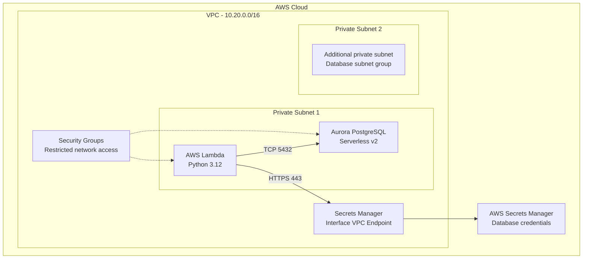
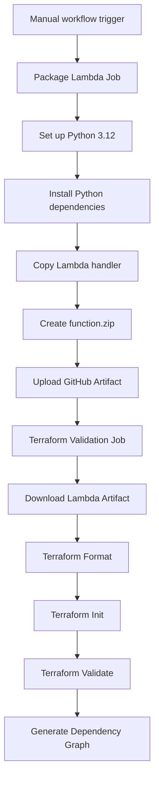

# AWS Infrastructure Automation with Terraform

A hands-on AWS Infrastructure as Code (IaC) learning repository using Terraform and GitHub Actions.

This repository contains practical infrastructure projects covering networking, compute, load balancing, relational databases, serverless computing, IAM security, and CI automation.

The primary focus is building modular, reusable, and security-conscious AWS infrastructure configurations.

---

## Projects

| Project | Technologies | Purpose |
|---|---|---|
| VPC, EC2 and ALB | Terraform, VPC, EC2, ALB | Infrastructure and load balancing |
| Aurora PostgreSQL and Lambda | Terraform, Aurora PostgreSQL, Lambda, IAM, Secrets Manager | Serverless application and database integration |

---

# Project 1: Aurora PostgreSQL and AWS Lambda

## 1. Project Overview

This project demonstrates how to design AWS infrastructure using Terraform modules to connect an AWS Lambda function with an Amazon Aurora PostgreSQL database.

The architecture uses private networking, security groups, IAM permissions, and AWS Secrets Manager to provide a secure communication path between the application and database.

### Objectives

- Build modular Terraform infrastructure.
- Design private VPC networking.
- Configure Amazon Aurora PostgreSQL Serverless v2.
- Deploy a Python-based Lambda function through Terraform configuration.
- Securely retrieve database credentials using Secrets Manager.
- Apply least-privilege IAM permissions.
- Automate Terraform validation and Lambda packaging using GitHub Actions.

## 2. Architecture

The following diagram represents the intended infrastructure design.



### Architecture components

| Component | Responsibility |
|---|---|
| VPC | Provides isolated network infrastructure |
| Private subnets | Host private application and database networking |
| Security groups | Restrict communication between resources |
| Aurora PostgreSQL | Managed relational database |
| Aurora Serverless v2 | Automatically adjusts database capacity within configured limits |
| AWS Lambda | Runs the Python application code |
| Secrets Manager | Stores and provides database credentials |
| IAM role | Grants Lambda the permissions required to execute |
| VPC interface endpoint | Allows private access to Secrets Manager |

## 3. Application Flow

The Lambda function is designed to perform the following operations:

1. Lambda function is invoked.
2. Lambda retrieves database credentials from AWS Secrets Manager.
3. Lambda establishes a secure connection to Aurora PostgreSQL.
4. Lambda executes a SQL query:

```sql
SELECT current_database(), version();
```

5. Aurora returns the database name and PostgreSQL version.
6. Lambda returns the result as a JSON response.
7. The database connection and cursor are closed.

### Expected application response

The following is an illustrative response from a successful database connection, not a result from a live deployment.

```json
{
  "statusCode": 200,
  "body": {
    "message": "Successfully connected to Aurora PostgreSQL",
    "database": "employee_db",
    "version": "PostgreSQL version information"
  }
}
```

## 4. Security Design

Security is an important part of this project.

| Security area | Implementation |
|---|---|
| Network isolation | Private subnets |
| Database exposure | Aurora is not publicly accessible |
| Database traffic | TCP port 5432 from Lambda security group |
| Secrets access | HTTPS port 443 through interface endpoint |
| Credentials | Managed master password in Secrets Manager |
| IAM | Lambda execution role with Secrets Manager read permission |
| Database encryption | Storage encryption enabled |
| Logging and VPC permissions | AWSLambdaVPCAccessExecutionRole policy |

### Network communication

The intended communication rules are:

- Lambda → Aurora PostgreSQL: TCP 5432
- Aurora → Lambda: No inbound connection required
- Lambda → Secrets Manager endpoint: TCP 443
- Other unrestricted inbound traffic: Not configured

The security groups use explicit ingress and egress rules to control communication.

## 5. Terraform Module Structure

The Aurora and Lambda infrastructure is organized into reusable Terraform modules.

```text
aurora-lambda/
│
├── modules/
│   │
│   ├── networking/
│   │   ├── main.tf
│   │   ├── variables.tf
│   │   └── outputs.tf
│   │
│   ├── aurora/
│   │   ├── main.tf
│   │   ├── variables.tf
│   │   └── outputs.tf
│   │
│   └── lambda/
│       ├── main.tf
│       ├── variables.tf
│       └── outputs.tf
│
├── lambda/
│   └── src/
│       ├── handler.py
│       ├── requirements.txt
│       └── package.ps1
│
├── main.tf
├── providers.tf
├── versions.tf
├── variables.tf
└── outputs.tf
```

### Module responsibilities

**Networking module**

- Creates the VPC.
- Creates private subnets.
- Creates Lambda security group.
- Creates Aurora security group.
- Creates Secrets Manager endpoint security group.
- Configures security group ingress and egress rules.
- Creates the Secrets Manager interface endpoint.

**Aurora module**

- Creates the DB subnet group.
- Creates the Aurora PostgreSQL cluster.
- Configures Serverless v2 scaling.
- Enables storage encryption.
- Enables managed master password management.
- Creates the Aurora database instance.

**Lambda module**

- Creates the Lambda IAM execution role.
- Attaches the Lambda VPC execution policy.
- Creates a Secrets Manager access policy.
- Creates the Lambda function.
- Configures private subnet networking.
- Passes database connection details through environment variables.

## 6. Lambda Application

**Language:** Python 3.12

**Database driver:** pg8000

**Handler:** `handler.lambda_handler`

The Lambda application is responsible for:

- Retrieving credentials from Secrets Manager.
- Connecting to Aurora PostgreSQL.
- Executing a test SQL query.
- Returning the query result.
- Closing database resources.

Dependencies are maintained in:

```text
aurora-lambda/lambda/src/requirements.txt
```

The deployment ZIP is generated as:

```text
aurora-lambda/lambda/function.zip
```

The ZIP contains the Python handler and its required dependencies.

## 7. GitHub Actions CI Pipeline

GitHub Actions automates Terraform validation and Lambda packaging.

Workflow:

```text
.github/workflows/terraform.yml
```

### Pipeline architecture



### Pipeline activities

| Step | Activity |
|---|---|
| 1 | Manually trigger GitHub Actions |
| 2 | Install Python 3.12 |
| 3 | Install Lambda dependencies |
| 4 | Package Lambda source code |
| 5 | Upload ZIP as GitHub Actions artifact |
| 6 | Download ZIP in validation job |
| 7 | Run Terraform formatting |
| 8 | Initialize Terraform without a backend |
| 9 | Validate Terraform configuration |
| 10 | Generate Terraform dependency graph |

### CI/CD implementation

The workflow currently performs:

- Lambda ZIP packaging.
- Artifact upload and download.
- Terraform formatting.
- Terraform initialization.
- Terraform validation.
- Terraform dependency graph generation.

The workflow does not currently perform AWS authentication or deployment.

## 8. Tools and Technologies

| Technology | Usage |
|---|---|
| Terraform | Infrastructure as Code |
| AWS VPC | Network isolation |
| Amazon Aurora PostgreSQL | Relational database |
| Aurora Serverless v2 | Database capacity management |
| AWS Lambda | Serverless compute |
| AWS Secrets Manager | Credential management |
| AWS IAM | Access control |
| AWS Security Groups | Network security |
| Python | Lambda application |
| pg8000 | PostgreSQL connectivity |
| GitHub | Source code management |
| GitHub Actions | CI automation |

## 9. Current Project Status

**Implementation status: Infrastructure code and CI validation**

Completed:

- Terraform module structure.
- Networking configuration.
- Aurora PostgreSQL Terraform configuration.
- Lambda Terraform configuration.
- IAM permissions.
- Secrets Manager integration design.
- Python Lambda handler.
- Lambda packaging workflow.
- Terraform validation workflow.

Not performed:

- Terraform plan.
- Terraform apply.
- AWS infrastructure provisioning.
- Live Lambda invocation.
- Live Aurora database connectivity test.

The architecture and application flow describe the intended deployment, not an existing running AWS environment.

## 10. Cost Considerations

This repository is currently maintained as a code and CI learning project.

No AWS resources are provisioned by the current GitHub Actions workflow.

Important: Deploying this architecture may incur AWS charges, including:

- Aurora Serverless v2 database capacity and storage.
- Secrets Manager secret storage and API requests.
- Interface VPC endpoint hourly and data processing charges.
- Lambda requests and execution beyond applicable free allowances.
- Other associated AWS infrastructure charges.

Review AWS pricing and regional availability before deploying.

## 11. Learning Outcomes

This project provides practical experience with:

- Terraform modules and reusable infrastructure.
- AWS networking and private subnet design.
- Aurora PostgreSQL architecture.
- Serverless application integration.
- IAM roles and policies.
- Secrets Manager integration.
- Security group traffic control.
- Python database connectivity.
- Lambda deployment packaging.
- GitHub Actions automation.
- Infrastructure validation without deployment.

---

# Project 2: VPC, EC2 and Application Load Balancer

The repository root also contains a Terraform project focused on foundational AWS infrastructure.

### Main components

- Amazon VPC
- Application Load Balancer
- EC2 instance
- Security groups
- Target group integration

**Primary objective:** Understand how to organize AWS networking and compute resources using Terraform modules and connect an EC2 application to an Application Load Balancer.

---

## Repository

GitHub: https://github.com/testing-acc-actions/terraform-task

## Disclaimer

This repository is an educational and practical Infrastructure as Code portfolio.

The Terraform configurations demonstrate infrastructure design and automation practices. Successful CI validation does not guarantee that every resource can be deployed in AWS; deployment requires additional testing, configuration, and cost review.
